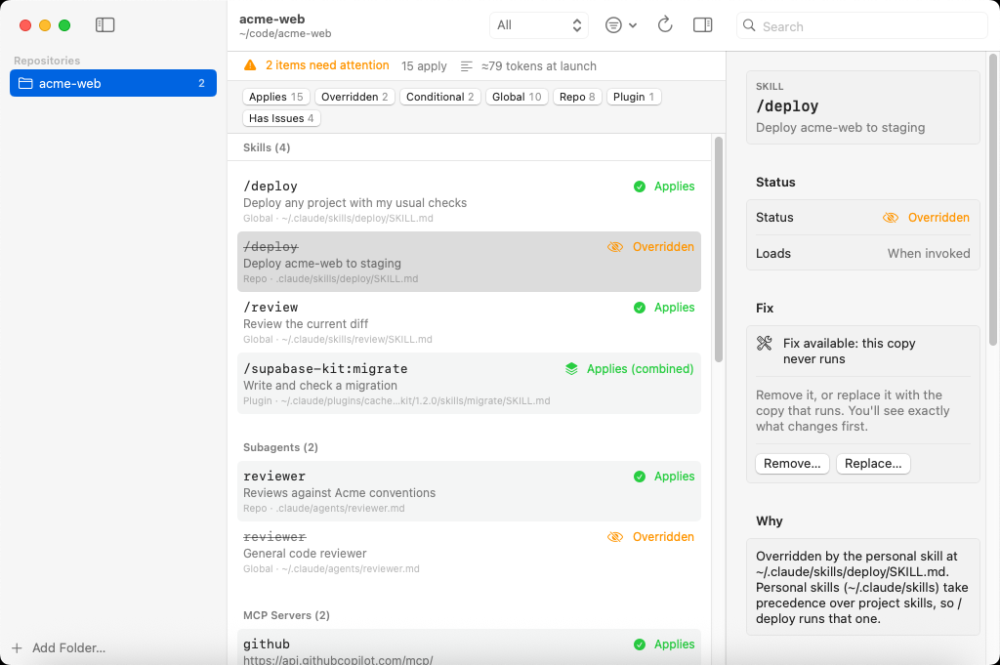
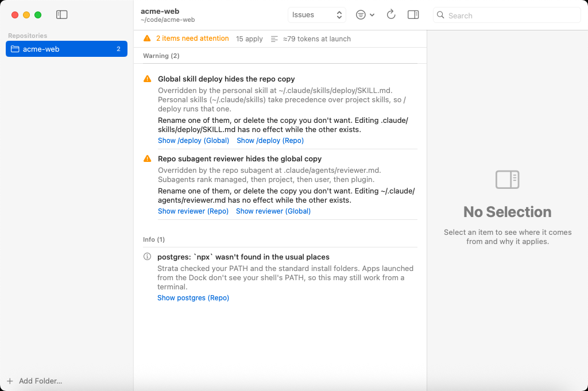
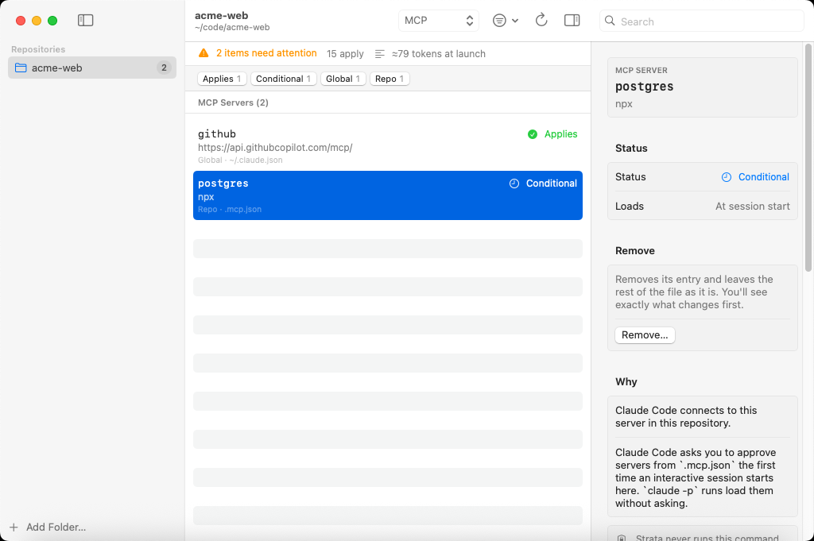

# Strata

Strata is a native macOS app that shows where your Claude Code configuration comes from. Pick a repository and it lists every skill, command, subagent, MCP server, plugin, instruction file and setting that would apply in a new session there. For each one it shows:

- which copy wins
- which copies it overrides
- the file each copy lives in
- why the winner wins

It's for questions like *"Why isn't my repo's `/deploy` skill running?"* (a personal one with the same name wins) or *"Which `.mcp.json` server needs approval?"*.

Strata is read-only. It never edits Claude Code configuration, runs MCP servers, or makes network requests.



| Issues | An MCP server awaiting approval |
| --- | --- |
|  |  |

Screenshots are captured from the real app by CI whenever the app changes on `main`, using made-up configuration.

## Requirements

- macOS 15 Sequoia or later. CI tests every release on macOS 15 and 26.
- Apple silicon or Intel

## Install

```bash
brew tap dillan-03/strata https://github.com/Dillan-03/strata
brew install --cask dillan-03/strata/strata-inspector
```

Or download `Strata-<version>.zip` from [Releases](https://github.com/Dillan-03/strata/releases), unzip it, and move `Strata.app` to Applications.

> [!IMPORTANT]
> Until Developer ID signing is set up ([#22](https://github.com/Dillan-03/strata/issues/22)), releases are **unsigned pre-releases**, and macOS blocks the first launch. Right-click Strata in Finder and choose **Open**, or run `xattr -dr com.apple.quarantine /Applications/Strata.app`. Each release's notes say whether that build is signed.

| Task | Command |
| --- | --- |
| Upgrade | `brew upgrade --cask strata-inspector` |
| Uninstall | `brew uninstall --cask strata-inspector` |
| Uninstall and remove Strata's preferences and caches | `brew uninstall --zap --cask strata-inspector` |

Uninstalling never touches `~/.claude`, `~/.claude.json`, your repositories, or anything belonging to another app. [docs/distribution.md](docs/distribution.md) lists exactly what `--zap` removes.

## What it reads

| Kind | Sources |
| --- | --- |
| Skills and commands | `~/.claude/skills`, `.claude/skills` (including nested folders), `.claude/commands`, managed skills, plugin skills, claude.ai synced skills |
| Subagents | `~/.claude/agents`, `.claude/agents`, managed and plugin agents |
| MCP servers | `~/.claude.json` (user and per-project), `.mcp.json`, plugin `.mcp.json` and `plugin.json` |
| Plugins | `enabledPlugins` in every settings file, `~/.claude/plugins/installed_plugins.json` |
| Instructions | `CLAUDE.md`, `.claude/CLAUDE.md`, `CLAUDE.local.md`, `.claude/rules`, `AGENTS.md`, parent folders, `@imports` |
| Settings | Managed, `~/.claude/settings.json`, `.claude/settings.json`, `.claude/settings.local.json` |

Managed configuration is read from `/Library/Application Support/ClaudeCode`. `CLAUDE_CONFIG_DIR` is honoured when the app inherits it.

Every precedence rule Strata applies is written down, with a link to the Claude Code documentation it comes from, in [docs/configuration-resolution.md](docs/configuration-resolution.md).

## Privacy

- No accounts, analytics, telemetry or network requests.
- Read-only: there is no code path that writes Claude Code configuration.
- MCP server commands are displayed, never run. Remote servers are never contacted.
- Values that look like credentials (API keys, tokens, passwords, `Authorization` headers, secret-looking environment variables) are masked before they reach the UI.
- Strata stores only its own settings and the list of repositories you've added, in `~/Library/Preferences/com.dillankerai.strata.plist`.

## Limitations

- **Strata can't see inside a running Claude Code session.** It reads files on disk and reports what *applies* to a new session started at the repository root. A session that's already running may have loaded something else. For example, plugin changes only take effect after `/reload-plugins` or a restart.
- It assumes `claude` is started at the repository root. Starting in a subdirectory can change which nested skills and instruction files load.
- Command-line flags (`--settings`, `--agents`, `--add-dir`, `--plugin-dir`, `--mcp-config`), server-managed settings from the claude.ai console, MDM profiles and claude.ai connectors aren't visible to it.
- Workspace trust is stored in an undocumented form, so anything that depends on trust is shown as **Conditional**, not resolved.
- When the Claude Code documentation doesn't settle a rule, Strata shows **Unknown** rather than guessing.

## Manual setup required

These need the repository owner and can't be done by automation. Each issue has the exact steps.

| Issue | What | Blocks |
| --- | --- | --- |
| [#21](https://github.com/Dillan-03/strata/issues/21) | Branch protection and repository settings, including letting Actions open PRs | Enforced CI on `main`; the automatic cask PR after a release |
| [#22](https://github.com/Dillan-03/strata/issues/22) | Apple Developer ID certificate and App Store Connect API key as repository secrets | Signed, notarised releases |

## Development

```bash
swift test --package-path Packages/StrataCore   # the rules engine; runs on macOS and Linux
brew install xcodegen
cd App && xcodegen generate && open Strata.xcodeproj
```

- [docs/architecture.md](docs/architecture.md): how the app and the rules engine fit together, and why the app isn't sandboxed.
- [docs/development.md](docs/development.md): local setup, project layout, linting.
- [docs/testing.md](docs/testing.md): the test suites and how CI runs them.
- [docs/release-process.md](docs/release-process.md): tagging, signing and publishing.
- [CONTRIBUTING.md](CONTRIBUTING.md): the issue → branch → PR workflow.

## License

[MIT](LICENSE)
